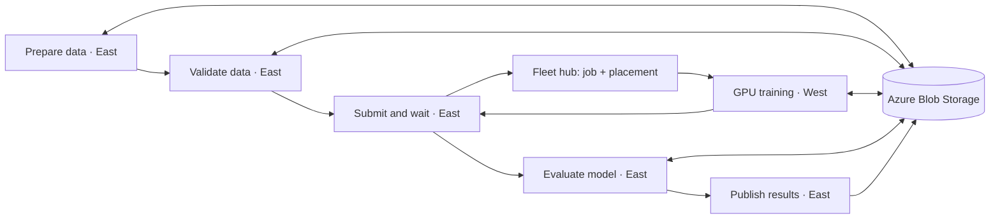

# Multi-step GPU training with shared Blob storage

Prepare data in East, train on a GPU in West through Fleet, and evaluate the saved model back in East. Five Kubeflow pipeline tasks exchange artifact references; Azure Blob Storage holds the actual dataset, model, checkpoint, and metrics.

| Task | Execution | Output in Blob Storage |
| --- | --- | --- |
| Prepare data | East CPU | Training/validation JSON files and dataset manifest |
| Validate data | East CPU | Validated manifest with checksums, schema checks, and row counts |
| Train remotely | East submits/waits; West GPU trains | Model weights, PyTorch checkpoint, training manifest |
| Evaluate model | East CPU | Validation mean squared error and quality decision |
| Publish results | East CPU | Result manifest linking the data, model, metrics, cluster, and GPU |

## What this demonstrates

- Actual cross-region file access: West downloads the training data East uploaded, then East downloads the model West saved.
- Actual CUDA execution. There is no CPU fallback for training.
- Dataset and model provenance: references include a SHA-256 checksum and byte count, and every run has an isolated `runs/<run-hash>/` prefix.
- A real downstream computation: evaluation on held-out data, followed by publication only if mean squared error meets the threshold.
- Workload Identity for Blob access. No storage account keys or SAS tokens are embedded in the pipeline.

The reproducible dataset is generated by the first task and **persisted to Blob**, rather than generated independently inside the GPU job. It contains no customer data. The model is a small eight-feature linear regression model; its purpose is to make data flow and GPU execution easy to verify.

## Run it

1. Follow [setup](SETUP.md), including image build, identities, and Fleet API access.
2. Start the five-task pipeline using the command in that guide.
3. Inspect the completed task graph in Kubeflow and the datasets, model, and metrics in Azure Portal.
4. Use [operations](OPERATIONS.md) for reset, cancellation, and troubleshooting.

See [validation](VALIDATION.md) for exactly what has been tested.

## How Fleet fits

The East `train-remotely` component uses a namespace-scoped hub connection to create a PyTorchJob and ResourcePlacement in `blob-training`. The RP selects that exact job and uses **PickFixed** with the `target_member` parameter, defaulting to `demo-west`. This deliberately makes the destination explicit without changing Example 2's member labels. Fleet propagates the job; West's Training Operator creates the GPU pod.

The component discovers the scheduled target from RP status, checks the remote job's `Succeeded` condition, fetches CUDA logs, and verifies its Blob training manifest. Placement availability alone is not treated as training success. The pipeline task stays in East; only the separate training job runs in West.

Kubeflow's own metadata and internal log storage remain in the existing East installation. Blob Storage holds this demo's application datasets and model artifacts.

The namespace shell is placed through a `NamespaceOnly` CRP. Service accounts, Azure identity federation, and scoped Kubernetes API access are prepared separately. Adding another eligible target requires preparing those dependencies and its observer connection first.

## Parameters and source

- `storage_account`: required Azure Storage account name.
- `container`: default `fleet-demo4`.
- `target_member`: default `demo-west`; must be prepared and present in the connections Secret.
- `mse_threshold`: default `0.02`. A lower threshold can intentionally demonstrate evaluation failure.

[`pipeline.py`](pipeline.py) defines the graph. [`src/tasks.py`](src/tasks.py) contains CPU steps; [`src/train.py`](src/train.py) contains GPU training. [`src/remote.py`](src/remote.py) constructs the job and placement and waits for completion. [`src/storage.py`](src/storage.py) handles authenticated Blob operations and checksum validation.

The committed [pipeline.yaml](pipeline.yaml) is a generated reference with placeholder image locations. Run the build script to create your own importable YAML under ignored `.state/`. Its images are pinned by digest. Share that YAML with the setup guide; recipients need access to those images or must build their own. No API credentials are exported with it.

## Boundaries

This is a custom Kubeflow-to-Fleet integration sample. It does not transparently convert existing pipelines, reserve GPU capacity, perform automatic failover, migrate GPU memory, or resume checkpoints. The checkpoint is saved for inspection and future extension. Publication writes a Blob result manifest; it does not register or deploy a model in an external service.

The storage account has one primary region; cross-region clients access the same authenticated HTTPS endpoint. This is shared access, not a storage disaster-recovery demonstration. Cross-region transfer has latency and bandwidth costs. Public anonymous access and Shared Key are disabled, but this small demo uses a publicly reachable authenticated endpoint; private endpoints and network policy are deployment-specific extensions.

Blob identity tokens are managed by Workload Identity. Hub/member Kubernetes API credentials are **separate, short-lived service-account tokens** that need refreshing before later runs. Stopping a pipeline does not automatically cancel its remote job. See [operations](OPERATIONS.md).
